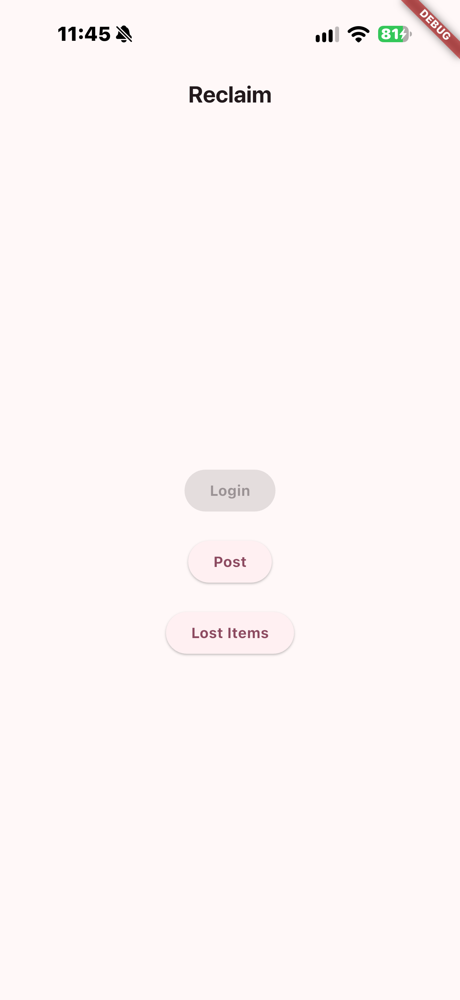
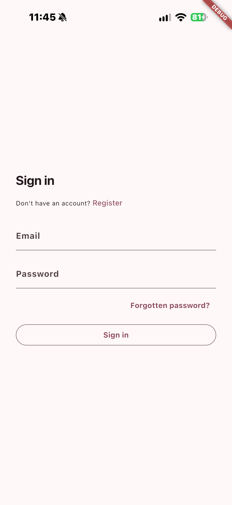
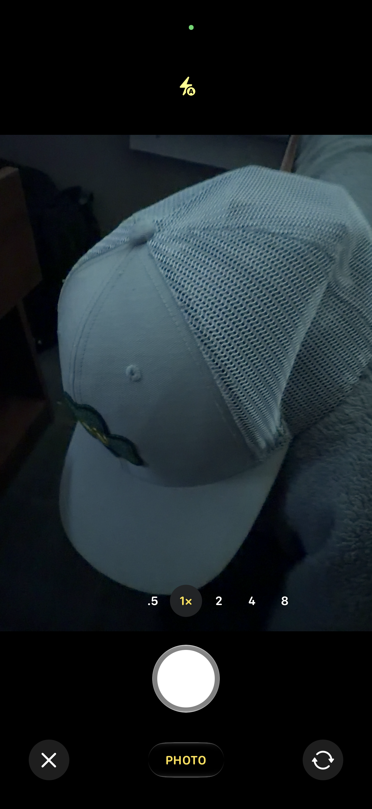
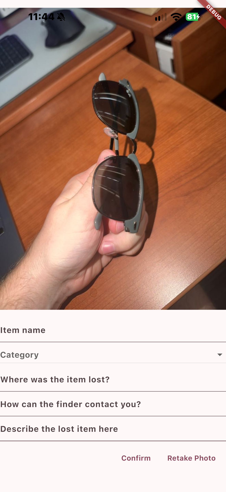
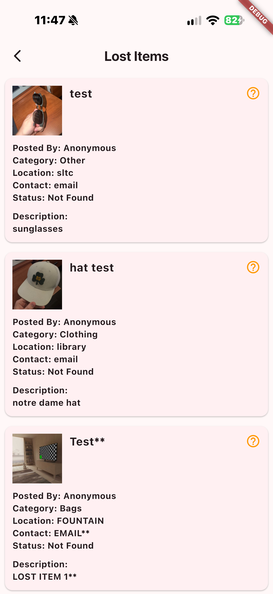

# Reclaim

Post found items, browse lost ones, all in one place. Take a picture and it's up for everyone to see.

## Audience

Students, staff, and visitors on a college campus. People who find something and want to get it back to its owner, and people who lost something and want to know if anyone turned it in.

## What it does

Log in with your email, tap Post, and the phone's camera opens. Take a picture of what you found, then fill in the name, category, where you found it, and how to reach you. Hit Confirm and it's saved to the cloud.

Tap Lost Items to see everything that's been posted, newest first. Each post shows the photo, the category, where it was found, who to contact, and whether it's been returned yet.

You have to be logged in to post, so every item comes from a real account. Anyone can browse the list.

## Why it's useful

Lost and found is usually a box in an office you have to go dig through. If you don't know which office has your stuff, you're out of luck. Reclaim puts it on your phone, so you can check from anywhere and see exactly where your item was found and who has it.

## Screenshots

The home screen

Signing in

Taking a picture of a found item

Filling in the item's details

Browsing lost items

